# Architecture

Bastion Backup has two layers.

- **`core/`** knows nothing about WordPress: the `.bbk` archive format, encryption, file scanning and archiving,
  database export and import, search/replace, and the restorer. The standalone installer bundles exactly these classes.
- **`includes/`** is the WordPress layer: settings, the backup key, the vault, jobs, destinations, the admin screens,
  admin-ajax, the OAuth callback, WP-CLI, Site Health and the installer builder.

```mermaid
flowchart LR
  subgraph Browser
    UI[Admin page<br/>assets/admin.js]
  end
  subgraph WordPress
    Ajax[Ajax.php<br/>cap + nonce + password]
    Jobs[Jobs.php<br/>lock, state, drivers]
    BJ[BackupJob]
    RJ[RestoreJob]
    Keys[Keys.php<br/>public half only]
    Vault[Vault.php<br/>destination secrets]
    Dest[Destinations<br/>Google Drive, OneDrive, File server]
    Cron[WP-Cron tick]
    CLI[wp bastion]
  end
  subgraph Core["core/ (no WordPress)"]
    AW[ArchiveWriter]
    AR[ArchiveReader]
    FS[FileScanner / FileArchiver]
    DBX[DbExporter / DbImporter]
    RS[Restorer / SearchReplace]
  end
  UI -->|tick, start, confirm| Ajax --> Jobs
  Cron --> Jobs
  CLI --> Jobs
  Jobs --> BJ & RJ
  BJ --> AW & FS & DBX & Dest
  RJ --> AR & RS & DBX & Dest
  BJ --> Keys
  Dest --> Vault
```



## The archive (`.bbk`)

```
"BBKARCH\x01" | u32 header_len | header JSON | frame* (u32 len | secretstream ciphertext)
```

- **Header:** public values only, `kdf = "x25519-seal"`, `kid` (key ID), `wk` = the random 32-byte data key sealed to the
  backup key's public half (`sodium_crypto_box_seal`), `ss` = the secretstream header, `frame`, `created`, `gen`.
  Passphrase archives (`kdf = "argon2id13"`) are still read and written by the core for tools and tests.
- **Frames:** XChaCha20-Poly1305 secretstream, at most 2 MiB of plaintext, deflated when that saves 3 % or more
  (never for media and archives). The SHA-256 of the header is the associated data of every frame, so the header
  cannot be swapped. The last frame carries `TAG_FINAL`: a cut-off archive is always detected.
- **Records:** `S` site manifest, `T` CREATE TABLE (name replaced by `` `__BBK_T__` ``), `Q` INSERT (≤ ~1 MiB), `D` folder,
  `F` file, `X` totals, `Z` end (inside the final frame, nothing after it).

## Jobs

One job at a time. Its state is `jobs/<id>.json` (mode 0600, written atomically); it holds stream state, which is key
material, and is deleted when the job ends. What the page sees is a filtered copy in the `bastion_backup_current_job`
option. Each step runs under `flock` until its deadline (the step setting, never more than 60 % of PHP's time limit),
then saves its place. Three drivers step the same job: the admin page polling `bbk_tick`, WP-Cron self-chaining
(`bastion_backup_tick` with unique arguments), and `wp bastion` in a loop.

```mermaid
stateDiagram-v2
  direction LR
  state Backup {
    [*] --> init --> db --> scan --> files --> finalize --> upload --> retain --> [*]
  }
  state Restore {
    [*] --> r_init
    r_init --> acquire: from a destination
    r_init --> verify: local or uploaded
    acquire --> verify
    verify --> ready: intact
    ready --> prepare: password + RESTORE
    prepare --> restore --> replace --> swap --> [*]
  }
```

- **Backup:** `init` makes the archive sealed to the key and writes the manifest. `db` dumps tables with keyset
  pagination. `scan` lists the files (breadth-first, resumable, symlinks skipped), then checks the free disk space.
  `files` streams them, splitting large ones mid-file. `finalize` writes the totals and the final frame. `upload` sends
  it to each destination in resumable chunks; one failing does not stop the others. `retain` keeps the newest N here
  and at each destination, deleting only this plugin's own names.
- **Restore:** `verify` reads and authenticates every byte and writes nothing. `ready` waits for the administrator.
  `prepare` remembers this plugin's own options and turns the maintenance page on. `restore` loads SQL into temporary
  tables and writes files as `*.bbk-part`, then renames them. `replace` rewrites the old address and paths in the
  temporary tables. `swap` runs one `RENAME TABLE`, puts the plugin's options back, keeps the plugin active and turns
  maintenance off, all in the same request.

## Destinations

`Destinations\Destination` (`upload`, `list`, `download`, `delete`, `test`, all resumable with a `$state` array).

| Destination | Access | Upload | Download |
|---|---|---|---|
| Google Drive | OAuth 2 + PKCE, scope `drive.file` | Resumable session, 8 MiB chunks, `Content-Range`; status query on resume | `alt=media` with `Range` |
| OneDrive | OAuth 2 + PKCE, `Files.ReadWrite.AppFolder` | `createUploadSession`, 10 MiB chunks; `nextExpectedRanges` on resume | pre-signed `downloadUrl` with `Range` |
| File server | SFTP (pinned host key) or FTPS (verified TLS) via curl | `<name>.part` appended step by step, size asked on resume, renamed at the end | `CURLOPT_RANGE` |

Adding S3, Dropbox or WebDAV is a new class and one line in `Registry::classes()`.

## Installer

`InstallerBuilder` concatenates `core/` (braced namespace blocks) and `installer/installer-template.php` into one
`installer.php`, with the `password_hash()` of a one-time access key. The template answers 404 when requested directly.
On the new server: access key (10 wrong tries lock it), choose the `.bbk` beside it, backup key, database, Test
connection, Check (verify only), then Restore: files, temporary tables, address and path replacement, swap, and
`wp-config.php` patched (or made with fresh salts). The backup key and database password stay in the browser and
come with each step; the reader's position is kept in a random working folder with deny rules, deleted at the end.
